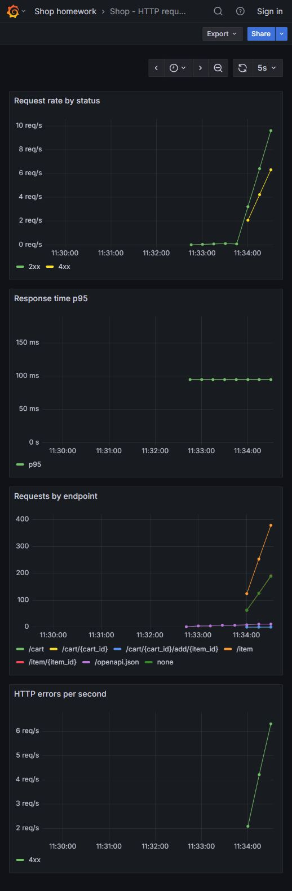
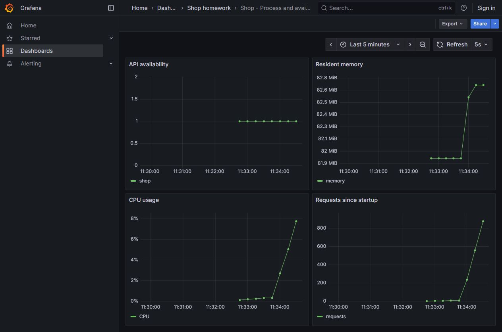

# ДЗ3: Docker и мониторинг

Используется магазин из ДЗ2. Добавлены Dockerfile, Compose, метрики Prometheus
и два дашборда Grafana. Данные магазина пока находятся в памяти одного процесса.

Из корня репозитория: `docker compose up -d --build --wait`.

- API: http://127.0.0.1:28000/docs
- Prometheus: http://127.0.0.1:19090/targets
- Grafana: http://127.0.0.1:13000 (учебный логин/пароль student / student)

Дашборды автоматически появятся в папке Shop homework.
Нагрузка: `python scripts/generate_load.py 120` (нужен httpx из requirements.txt).
Остановка: `docker compose down` из корня этого проекта.
При переключении между ветками пересоберите сервис через `--build`.

